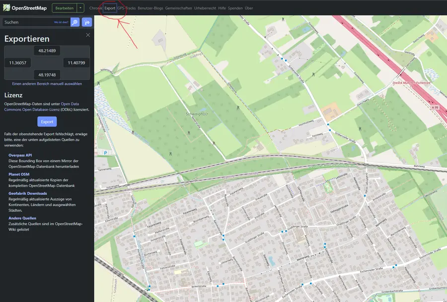
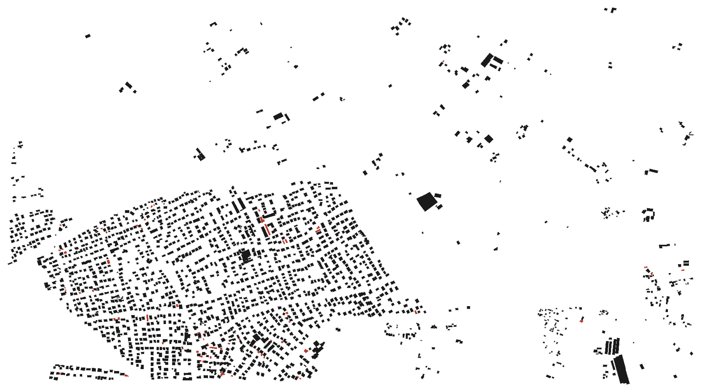

# OSM Schwarzplan — OpenStreetMap → CAD figure-ground plan

Turn **OpenStreetMap building data into a classic Schwarzplan** (figure-ground
plan / *Nolli map*): solid black building footprints on a white background —
and **export it to CAD as DXF**, or to **SVG / PNG**.

Point it at an `.osm` file, preview the plan, and export. Garages and carports
are separated onto their own layer so you can style or drop them.


## From OpenStreetMap to Schwarzplan

| 1 · Export an area from OpenStreetMap | 2 · Get a Schwarzplan (→ DXF / SVG / PNG) |
| --- | --- |
|  |  |

*Example area: Olching / Gröbenzell near Munich. Buildings in black, garages in
red, courtyards left white. Data © OpenStreetMap contributors (ODbL).*

## Features

- **Reads OSM XML** (`.osm`) — nodes, ways, and `type=multipolygon` building
  relations (courtyards become real holes).
- **Figure-ground rendering** — solid black footprints, white ground.
- **Two layers** — `BUILDINGS` and `GARAGES` (garages/carports auto-detected).
- **Live preview** with **zoom (mouse wheel)**, **pan (drag)**, **fit view**,
  and a **show/hide garages** toggle.
- **DXF export** with real area fill (`HATCH`, holes cut out) *and* outline
  polylines for CAD editing/snapping.
- **SVG export** (dependency-free) and **PNG export** (via Pillow).
- **Headless CLI** for batch conversion — no window required.
- **Correct filtering** — `building=no` is ignored; garages routed to their
  own layer.

## Installation

Requires **Python 3.8+**. `tkinter` ships with the standard Python installer.

```bash
git clone https://github.com/metamountain/osm-schwarzplan.git
cd osm-schwarzplan
pip install -r requirements.txt        # ezdxf (DXF) + Pillow (PNG); optional
```

`ezdxf` (DXF) and `Pillow` (PNG) are installed automatically on first use if
missing. Use `--no-install` to disable that. SVG export needs nothing extra.

## Usage

### GUI

```bash
python osm_schwarzplan.py
```

Then **Open file…**, or drag an `.osm` file onto **`run.bat`** (Windows).
In the preview: mouse-wheel to zoom, drag to pan, **Fit view** to recenter,
and **Export…** to save DXF / SVG / PNG.

### Command line (headless)

```bash
python osm_schwarzplan.py area.osm -o plan.dxf            # → DXF
python osm_schwarzplan.py area.osm -o plan.svg            # → SVG
python osm_schwarzplan.py area.osm -o plan.png --no-gui   # → PNG, no window
```

| Option | Meaning |
| --- | --- |
| `input` | Input `.osm` file (OSM XML). |
| `-o`, `--output` | Output file; format inferred from `.dxf` / `.svg` / `.png`. |
| `--no-gui` | Convert and exit without opening the window (needs `-o`). |
| `--no-install` | Do not auto-install missing packages. |

## Getting OpenStreetMap data

1. Go to **[openstreetmap.org](https://www.openstreetmap.org/)** and pan/zoom
   to your area.
2. Click **Export** and download the bounding box as an `.osm` file.
3. For larger areas use the **[Overpass API](https://overpass-api.de/)**,
   **[Geofabrik extracts](https://download.geofabrik.de/)**, or the
   raw **[OSM Map API](https://wiki.openstreetmap.org/wiki/API_v0.6#Retrieving_map_data_by_bounding_box:_GET_/api/0.6/map)**.

A small `sample.osm` is included so you can try the tool immediately.

## Configuration

Edit the constants near the top of `osm_schwarzplan.py`:

- `GARAGE_VALUES` — `building=*` values treated as garages.
- `LAYER_BUILDINGS` / `LAYER_GARAGES` — DXF layer names.
- `COLOR_*_HEX` / `DXF_COLOR_*` — preview and DXF colors.

## Project structure

See **[docs/PROJECT_STRUCTURE.md](docs/PROJECT_STRUCTURE.md)** for the file
layout, the processing pipeline, and developer notes.

## Keywords

OpenStreetMap · OSM · Schwarzplan · figure-ground plan · figure ground diagram ·
Nolli map · OSM to CAD · OSM to DXF · building footprints · DXF export · SVG ·
architecture · urban planning · Städtebau · GIS · ezdxf · Python · tkinter

## License

[MIT](LICENSE) © cybertect74.
OpenStreetMap data is © OpenStreetMap contributors, licensed under the
[ODbL](https://www.openstreetmap.org/copyright).
